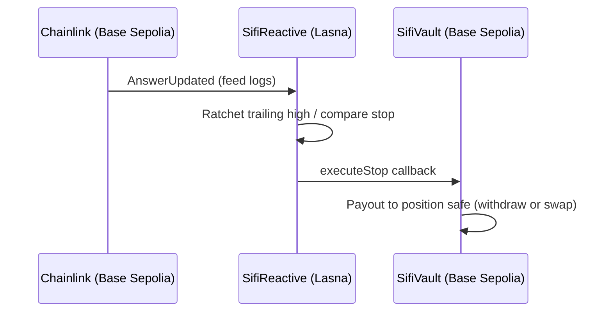

# Parachute

Set-it-and-forget-it trailing stop-loss vault on **Base Sepolia**, driven by a **Reactive Network** contract on **Lasna** that watches Chainlink price feeds.

## How it works



1. **SifiVault** holds per-position balances and arms fixed or trailing stops. Only the authenticated reactive callback may execute a stop.
2. **SifiReactive** subscribes to vault arm/disarm events and to Chainlink `AnswerUpdated` on the feed chain. On a hit it requests a cross-chain callback into the vault.
3. Idle feeds unsubscribe so an empty watcher does not burn subscription budget.

## Contracts

| Contract | Chain | ID | Role |
| -------- | ----- | --- | ---- |
| **SifiVault** | Base Sepolia | 84532 | Custody, arm/disarm, execute stop, payout |
| **SifiReactive** | Lasna | 5318007 | Feed subscriptions, trail ratchet, callback |

Sources: `contracts/src/sifi/SifiVault.sol`, `contracts/src/sifi/SifiReactive.sol`.

Deploy scripts: `contracts/script/sifi/` (`DeployParachuteReactive`, `DeployParachuteVault`, `ConnectParachute`, `OpenParachutePosition`, plus optional demo utilities).

Tests: `contracts/test/sifi/`.

## Deployed (testnet)

| | |
| --- | --- |
| **SifiVault** | `0x6947A35154A52e1110ABF897e8D297e176133F3D` |
| Explorer | https://sepolia.basescan.org/address/0x6947A35154A52e1110ABF897e8D297e176133F3D |
| Verified | https://sepolia.basescan.org/address/0x6947A35154A52e1110ABF897e8D297e176133F3D#code |

| | |
| --- | --- |
| **SifiReactive** | `0xdD7d918C65e20FB42e778564E3759EcCFe44c4f0` |
| Explorer | https://lasna.reactscan.net/address/0xdD7d918C65e20FB42e778564E3759EcCFe44c4f0 |
| Verified (Sourcify) | https://repo.sourcify.dev/contracts/full_match/5318007/0xdd7d918c65e20fb42e778564e3759eccfe44c4f0/ |

### Chainlink feeds (Base Sepolia)

| Pair | Aggregator |
| ---- | ---------- |
| ETH/USD | `0xa24A68DD788e1D7eb4CA517765CFb2b7e217e7a3` |
| BTC/USD | `0x961AD289351459A45fC90884eF3AB0278ea95DDE` |
| LINK/USD | `0xAc6DB6d5538Cd07f58afee9dA736ce192119017B` |

`AnswerUpdated` topic: `0x0559884fd3a460db3073b7fc896cc77986f16e378210ded43186175bf646fc5f`.

## Build & test

Requires [Foundry](https://book.getfoundry.sh/). Submodules: `lib/forge-std`, `lib/reactive-lib-omni`.

```bash
cd contracts
forge build
forge test
```

## Deploy

Owner-operated broadcasts only — sign with a local keystore (`cast wallet import`), not a raw key in the repo.

```bash
cd contracts
cp .env.example .env   # placeholders only; never commit .env
```

| Variable | Meaning (placeholders) |
| -------- | -------------------- |
| `BASE_SEPOLIA_RPC` | Public RPC URL |
| `LASNA_RPC` | Lasna RPC URL |
| `ETHERSCAN_API_KEY` | Optional verify key |
| `CALLBACK_PROXY` | Reactive callback proxy on Base Sepolia |
| `FEED_CHAIN_ID` / `VAULT_CHAIN_ID` | `84532` |
| `PARACHUTE_FEEDS` | Comma-separated feed aggregator addresses |
| `VAULT_FUNDING` | Vault constructor funding (**wei**), e.g. `10000000000000000` (0.01 ETH) |
| `REACTIVE_FUNDING` | Reactive deploy funding (**wei**), e.g. `2000000000000000000` (2 ETH) |
| `PARACHUTE_REACTIVE` | Set after step 1 |
| `PARACHUTE_VAULT` | Set after step 2 |
| `CALLBACK_GAS_LIMIT` | Callback gas limit, e.g. `1000000` |

Order: deploy **reactive** (Lasna) → **vault** (Base Sepolia, pass reactive address) → **connect** watcher to vault. Full walkthrough: `contracts/DEPLOY.md`.

```bash
forge script script/sifi/DeployParachuteReactive.s.sol:DeployParachuteReactive \
  --rpc-url "$LASNA_RPC" --broadcast --account test
# ... see DEPLOY.md for vault, connect, and optional OpenParachutePosition
```

## Layout

| Path | Purpose |
| ---- | ------- |
| `contracts/` | Foundry project (sources, tests, scripts) |
| `lib/` | `forge-std`, `reactive-lib-omni` |
| `scripts/` | Repo helpers (e.g. staged secret scan) |

## Security

Do not commit `.env`, keystores, mnemonics, or private keys. `.gitignore` excludes `broadcast/`, `cache/`, and `out/` artifacts that may contain deployment metadata.